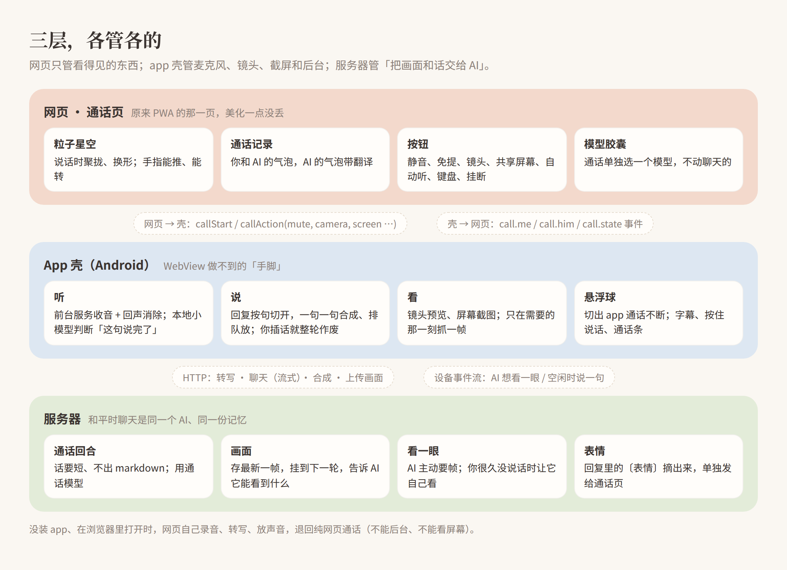
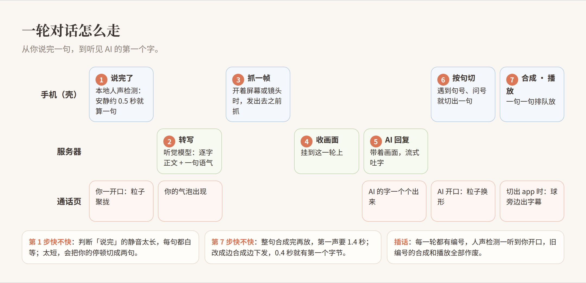
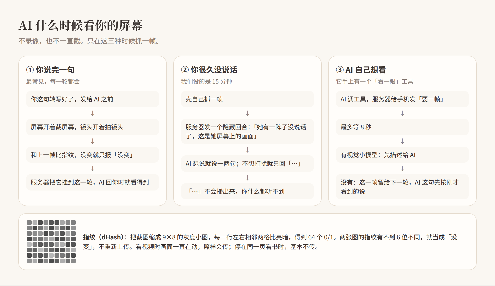
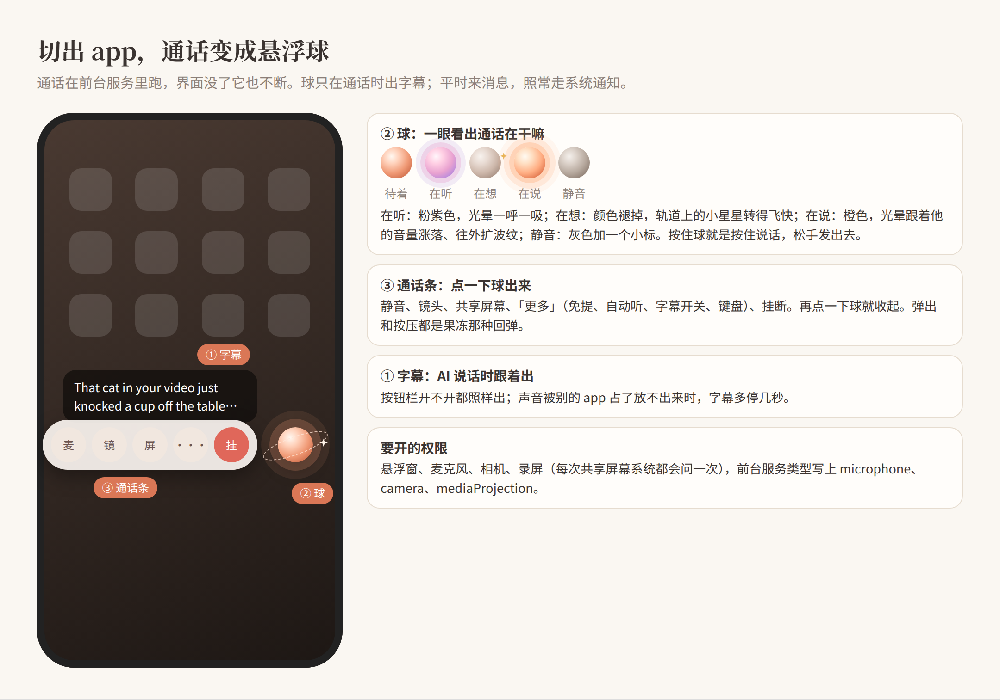
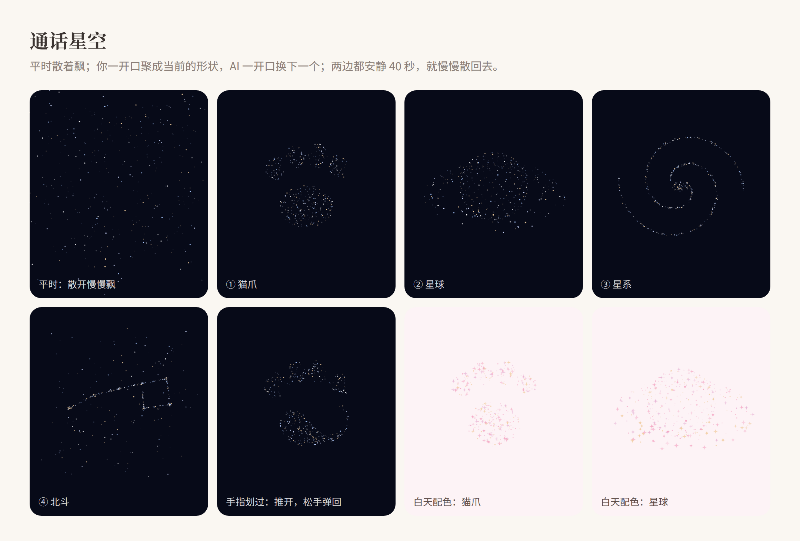

# 在通话里看见你：自建 AI 的语音通话、共享屏幕和镜头（Android 套壳篇）

> 适用于：自己搭了 AI 聊天网页（前端 + 后端），想给它加上**像打电话一样的语音通话**，并且通话里 AI 能看到你的**手机屏幕**或**镜头**。手机是 Android，打算或者已经用 WebView 套了一层 app 壳。
> 文中的「AI」就是你平时聊天的那一位，同一个人设、同一份记忆；「你」是打电话的人。
> 代码都是**改写过的最小示例**，用来讲清楚逻辑，不是完整源码。域名、令牌、模型名都换成了占位。
> 标 ⏳ 的部分是我们正在改、还没在真机上验收的做法。思路是确定的，细节可能还会调。

## 0. 最终效果

- 在聊天页点电话图标，就进入通话页：背景是一片会聚拢、会变形的粒子星空，中间是你和 AI 的通话记录。
- 你说话，AI 用它自己的声音回你；你可以随时插话打断它。
- 打开**共享屏幕**，你每说完一句，AI 都能看到你此刻的屏幕。你在刷视频、看小说、画画，它都能接上话。
- 打开**镜头**，AI 能看到你拍到的东西，右上角有一个可以翻转、可以关掉的小预览窗。
- 你很久没说话时，AI 会自己看一眼你的屏幕。想说就说一两句，不想打扰就安静。
- 切出 app，通话不断，变成一个悬浮球：它会显示 AI 在听、在想还是在说，AI 说话时旁边出字幕，按住球就能说话。
- 通话用的模型可以单独选，比如换一个不思考、回得快的，挂了电话回去打字，聊天模型还是原来那个。

---

## 1. 为什么要套一层壳

纯网页（PWA）也能打电话：网页录音，发给后端转写，拿到回复后合成语音再放出来。我们一开始就是这么做的。但在手机上，有四件事网页做不到：

| 想要的 | 网页的问题 | 壳怎么做 |
|---|---|---|
| 切出去通话不断 | 页面一到后台，录音和播放就被系统停掉 | 前台服务（`foregroundServiceType="microphone"`） |
| 看手机屏幕 | 手机浏览器没有 `getDisplayMedia` | `MediaProjection` 截屏 |
| 悬浮球、字幕 | 网页画不到别的 app 上面 | `SYSTEM_ALERT_WINDOW` 悬浮窗 |
| 回声消除、稳定收音 | 浏览器的处理不可控 | `AudioRecord` 用通话音源，加 `AcousticEchoCanceler` |

**原则是：通话页还是那一页网页，壳只做「手脚」。** 网页上的美化（皮肤、粒子、气泡）一点都不丢，改样子也不用重新打包 app。在浏览器里打开时，网页照旧自己录音、自己放，退回纯网页通话。

---

## 2. 三层分工



**网页和壳之间靠一座「桥」说话。**

壳往 WebView 里注入一个 `window.Shell` 对象，网页调它的方法；壳往网页发事件，网页监听：

```js
// 网页 → 壳：开始通话、按按钮
await Shell.callStart({ role: 'your-ai' });
await Shell.callAction({ action: 'mute', on: true });      // 静音
await Shell.callAction({ action: 'camera', on: true });    // 开镜头
await Shell.callAction({ action: 'screen', on: true });    // 共享屏幕（系统会弹授权框）
await Shell.callAction({ action: 'preview', rect: { x, y, w, h } });  // 告诉壳镜头预览框在哪
await Shell.callAction({ action: 'hangup' });

// 壳 → 网页：通话里发生了什么
window.addEventListener('shell', e => {
  const d = e.detail;
  if (d.type === 'call.me')    addBubble('me', d.text);        // 你这句的转写
  if (d.type === 'call.him')   appendHim(d.delta);             // AI 的字，一段一段来
  if (d.type === 'call.state') setStatus(d);                   // 在听 / 在想 / 在说 / 静音…
  if (d.type === 'call.face')  setFace(d.face);                // AI 回复里的表情
});
```

壳那头，用 `WebViewCompat.addDocumentStartJavaScript` 在每个页面加载前注入这个对象，再用 `addWebMessageListener` 收网页的调用。**注入时限定成你自己的域名**，别的网页拿不到这座桥。

---

## 3. 一轮对话怎么走



### 3.1 收音，以及判断「这句说完了」

壳里一个前台服务一直开着麦克风：

```kotlin
val rec = AudioRecord(
    MediaRecorder.AudioSource.VOICE_COMMUNICATION,   // 通话音源：系统会做降噪、自动增益
    16000, AudioFormat.CHANNEL_IN_MONO, AudioFormat.ENCODING_PCM_16BIT, bufSize)
if (AcousticEchoCanceler.isAvailable())
    AcousticEchoCanceler.create(rec.audioSessionId)?.enabled = true   // 不然 AI 的声音会被当成你在说话
```

「这句说完了」交给手机本地一个很小的人声检测模型 **Silero VAD**（ONNX 格式，用 onnxruntime 跑，约 2 MB，MIT 许可证）。最早我们靠音量大小判断：开头要先校准两秒，轻声说话、环境吵的时候都容易判错，句首还经常被吃掉。后来换成了它。每 512 个采样点（32 毫秒）问它一次「这一小段是人声的概率」：

```kotlin
// 每 32ms 一帧
val loud = silero.probability(frame) >= 0.5f
if (!speaking) {
    lead.addLast(frame); if (lead.size > 16) lead.removeFirst()   // 一直留着最近 0.5 秒
    if (loud) { speaking = true; pcm.write(lead); lead.clear() }   // 开口了：把开口前那 0.5 秒也带上
} else {
    pcm.write(frame)
    quiet = if (loud) 0 else quiet + 512
    if (quiet >= 7680 || pcm.size() >= 960_000) {   // 安静 0.48 秒，或者已经说了 30 秒
        onSegment(pcm.toByteArray()); reset()       // 这一句交出去
    }
}
```

两个数字值得自己调：
- **「开口前 0.5 秒」**：人声检测总会慢半拍，不带上这一段，你每句话的第一个字都会被吃掉。
- **「安静多久算说完」**：太长，每句都白等；太短，你想一下的停顿就被切成两句。我们用 0.48 秒。

另外留了一个「按住说话」：长按悬浮球或通话页的按钮时不看模型，按住期间全收，松手就算一句。适合环境吵的时候。

### 3.2 转写：用听觉模型，顺便听语气

我们没有用专门的语音识别服务，而是把这段音频直接交给一个**能听音频的多模态模型**（我们现在用的是 Qwen-Omni；也可以接 Gemini，方法见星轨工坊的《给 AI 装耳朵》）。好处是它不光转文字，还能顺带听出语气。

通话里的转写提示词：

```
转写这段通话语音。严格按两行输出，不要多余文字：
第一行只写说话的逐字正文；
第二行以 ◈ 开头，用一句话概括语气、情绪与背景声音。
若听不清正文则第一行写「（听不清）」。
```

第一行当成你这句话发给 AI，第二行作为补充信息一起带上。AI 就知道你是笑着说的、叹着气说的，还是旁边在放音乐。

### 3.3 服务器：通话回合和打字回合不一样

壳先调转写接口拿到文字（第 3.2 节），再发给和平时聊天**同一个**接口，只多带一个 `channel: "call"`。服务器认出这是通话回合，做几件事：

1. **提醒 AI 这是在打电话。** 比如「你写的正文会被逐句朗读出来，写出来就等于说出口；不要 markdown、不要列点、不要代码块；一次一到三句短句，说完把话头留给对方」。不加这句，它会在电话里念出「第一点：」。
2. **用通话模型。** 详见第 5 节。
3. **把画面挂上来。** 详见第 4.5 节。
4. **把表情摘出来。** AI 的设定里允许它在回复里写 `〔表情:开心〕` 这样的标签（开心、害羞、生气、哭、傲娇五种，只在情绪明显时用，一条最多一个）。服务器在流式输出里把标签剥掉、单独发一个 `face` 事件给通话页，正文里不留，也不会被念出来。通话页现在只把它显示成一个小标签，按表情换成不同的图是下一步。

```python
# 通话回合的模型：单独选，并且不改这段对话记住的模型
if is_call_turn:
    call_model = settings.get("call_model") or ""
    if call_model:
        body.model = call_model
    # 非思考模型就别传思考强度，不然有的线路会报错或者白等
    if "thinking" not in body.model.lower():
        payload.pop("reasoning_effort", None)
if not is_call_turn:
    remember_conversation_model(conv_id, body.model)   # 只有打字回合才记
```

### 3.4 说出来：分句、合成、排队，你一插话就作废

AI 的回复是一个字一个字流回来的。壳不等它说完，**攒够一句就送去合成**：

- 遇到句号、问号、感叹号、分号、冒号、换行，就切出一句。
- 代码块、链接、括号、方括号里的内容不切，`〔表情〕` 这种标签也不切开。
- 每一句单独请求一次 TTS，合成好的音频按顺序排队播放。下载和播放是两个协程：放第一句的同时，第二句已经在下载了。

**插话**：每一轮都有一个递增的编号（generation）。人声检测一听到你开口，编号就加一，正在播的停掉，旧编号还没下载完、没播的全部丢掉，旧编号的回调也不能再往字幕里塞字。

**⏳ 更快的第一声。** 下面三条来自すみか老师的《自建前端 AI 语音通话优化教程》，我们正在改，第一条服务器已经上线：
- **边合成边下发**。我们用的 TTS 是 MiniMax，它支持 `stream: true`。服务器加了一个流式接口，在服务器上实测同一句话：整段合成要 1.44 秒才拿到第一个字节，流式 0.38 秒就有第一个字节，0.63 秒全部收完。播放端用一个「会长大」的数据源，边下边放。
- **第一句切短**。遇到句末就发；或者累计 12 个字以后遇到逗号，也可以先发。后面的句子超过 20 个字、遇到标点就发，48 个字封顶。
- **同时开两个合成请求**，播放还是按顺序。请求槽位不等于播放槽位：下载完就释放槽位，不要等前一句放完才去下一句。

**⏳ 声音别被抢走。** 每次 AI 开口时，申请一次「临时、允许别人降低音量」的音频焦点，说完再还回去：

```kotlin
val req = AudioFocusRequest.Builder(AudioManager.AUDIOFOCUS_GAIN_TRANSIENT_MAY_DUCK)
    .setAudioAttributes(AudioAttributes.Builder()
        .setUsage(AudioAttributes.USAGE_VOICE_COMMUNICATION).build())
    .setOnAudioFocusChangeListener { change -> /* LOSS: 停当前这句，下一句重新申请 */ }
    .build()
audioManager.requestAudioFocus(req)       // AI 开口时
// …最后一句放完 300ms 后
audioManager.abandonAudioFocusRequest(req)
```

这样你边看视频边打电话时，AI 一开口，视频声音自动变小，说完恢复。为什么要这样做，见第 8 节第 1 个坑。

---

## 4. 看见你：共享屏幕和镜头



### 4.1 只在三种时候抓一帧

我们**不录像，也不一直截图**，原因有三个：费流量、费电，而且模型一次只看得了一张图。抓帧只发生在三种时候：

1. **你说完一句**：转写好、发给 AI 之前，先抓一帧（见第 3 节的图）。屏幕开着就截屏幕；镜头开着就拍镜头；两个都开时，这一轮两张都带上。
2. **你很久没说话**：我们设的是 15 分钟。壳自己抓一帧上传，服务器替 AI 发起一个看不见的回合（见 4.5）。
3. **AI 自己想看**：它有一个「看一眼」工具。调用后服务器通过设备事件流让手机抓一帧，最多等 8 秒。

共享屏幕的规矩是**一视同仁**：只要开着，不管你当前在不在聊天 app 里，每次说话都截当前的屏幕。

### 4.2 指纹去重：画面没变就不传

每次抓到图，先算一个 64 位的「差值哈希」（dHash），和上一张比：

```kotlin
fun dHash(bmp: Bitmap): Long {
    val s = Bitmap.createScaledBitmap(bmp, 9, 8, true)    // 缩成 9×8
    val px = IntArray(72); s.getPixels(px, 0, 9, 0, 0, 9, 8); s.recycle()
    fun luma(c: Int) = (c shr 16 and 255) * 299 + (c shr 8 and 255) * 587 + (c and 255) * 114
    var h = 0L
    for (y in 0 until 8) for (x in 0 until 8)              // 每行相邻两格比亮暗 → 64 个 0/1
        if (luma(px[y * 9 + x]) > luma(px[y * 9 + x + 1])) h = h or (1L shl (y * 8 + x))
    return h
}
val unchanged = last?.let { java.lang.Long.bitCount(it xor hash) < 6 } ?: false
```

不到 6 位不同就当成「没变」，只告诉服务器 `unchanged=true`，不传图。你停在同一页看书时基本不传；刷视频时画面一直在变，照样会传。

上传的图长边缩到 960，JPEG 质量 70。

### 4.3 ⏳ 截屏：只在要的时候才转图

`MediaProjection` 会把屏幕画面不停地送进一个 `ImageReader`。最直觉的写法是在每一帧的回调里转成 Bitmap 存起来。**别这样做。** 我们一开始就是这么写的：每一帧整屏分配、拷贝三遍。看视频时一秒几十帧，手机直接发烫、变卡，通话里的录音都被挤得断断续续。

正确的写法是，回调里只把帧取出来马上关掉，真正要图时才转一次：

```kotlin
reader.setOnImageAvailableListener({ r ->
    r.acquireLatestImage()?.use { lastFrameAt = SystemClock.elapsedRealtime() }  // 只记时间，马上关掉，让队列继续流动
}, handler)

suspend fun snapshot(): Bitmap? {
    wantNext = true
    val img = waitNextImage(timeoutMs = 150) ?: return null   // 等一张新鲜的
    return img.use { toBitmapScaled(it, longEdge = 960) }     // 只转这一张，直接转成最终尺寸
}
```

虚拟屏本身也直接按长边 960 建，不要按手机原分辨率建了再缩小。

截图前，先把自己的悬浮球和字幕藏起来，截完再放回去，不然 AI 看到的每一张图上都有一个球。

### 4.4 镜头：原生预览叠在网页上

镜头用 CameraX，接两路：
- `Preview`：给你看的小预览窗；
- `ImageAnalysis`：给 AI 截帧，用 `STRATEGY_KEEP_ONLY_LATEST`，只保留最新一帧。

预览窗是原生 View，可通话页是网页。做法是：网页里留一个空的预览框，把它在屏幕上的位置告诉壳，壳把原生预览盖在那个位置。

```js
function syncPreview() {
  const el = document.getElementById('callPreview');
  if (!el || el.hidden) return Shell.callAction({ action: 'preview', rect: null });  // 藏起来
  const r = el.getBoundingClientRect();
  Shell.callAction({ action: 'preview', rect: { x: r.left, y: r.top, w: r.width, h: r.height } });
}
new ResizeObserver(syncPreview).observe(document.getElementById('callPreview'));
```

翻转、关闭的按钮放在网页这一侧，点了再通过桥告诉壳。

### 4.5 服务器：怎么把画面交给 AI

手机上传到 `POST /api/call/{id}/frame`，带上 `source`（屏幕还是镜头）、`trigger`（说话时、空闲时、AI 要的）、`unchanged` 和图片本身。服务器的做法：

1. **每个来源只记最新的一帧待用。** 图片文件存进这段通话所属对话的附件目录，和你在聊天里发的图片放在一起。
2. **挂到下一轮。** 这一轮 AI 回复时，把这张图当成你这句话的附件一起发给模型，然后标记「已经给过了」，不会每轮重复发同一张。
3. **告诉 AI 它现在看得到什么**。不说的话，模型不知道自己在视频通话里，你开了镜头它也当没看见。每一轮的上下文里加一行，分三种情况：
   - 这一轮附了图：「你看得见，这条消息附的图是她的屏幕（刚刚）。自然地把看到的融进话里，别逐项描述图片」；
   - 看得见，但这一轮没有新图：「你看得见她的屏幕（最近一帧 40 秒前），想看此刻就调『看一眼』工具」；
   - 没开：「她这通没开镜头也没共享屏幕，你只能听」。

   超过 3 分钟没有新帧，就按「没开」处理，免得 AI 对着一张旧图说「你正在……」。「别逐项描述图片」这句很要紧，不加的话它会像读图说明一样把画面一项项念出来。
4. **空闲时看一眼**是一个隐藏回合，你的那句话不显示在记录里：

```python
async def idle_look(call, frame_path, source):
    if chat_lock.locked():          # AI 正在回别的话，就不插这一句
        return
    msg = ("[语音通话] [她有一阵子没说话了，这是刚从她" + ("屏幕" if source == "screen" else "镜头")
           + "看到的画面。想接着聊就说一两句——比如她在看什么、画什么；不想打扰就只回一个「…」，什么都不会播出去]")
    text = await hidden_turn(call.conv_id, msg, attachments=[frame_path], channel="call")
    if text.strip("…. 。"):         # 只有真说了话才推给手机念出来
        publish(call.role, "call.say", {"call_id": call.id, "text": text})
```

「回『…』就不出声」很重要。不给它这个台阶，它每 15 分钟都会硬找话说。

### 4.6 边界

- 镜头和屏幕都**只在通话进行中**才会抓，挂断就停。共享屏幕每次开都要你在系统授权框里点同意。
- 壳的设置里，镜头、屏幕各有一个总开关；还有一个「暂停」，按下后所有抓帧和上传都停。
- 没有录像，只有被抓到的那几帧。它们和聊天里发的图片一样存在对话的附件里；想定期清理，可以按文件名前缀 `call-` 写一个清理任务。

---

## 5. 通话页：按钮和模型胶囊

**按钮**全部是线条图标（1.8 线宽、圆头圆角），开着的填主色：

| 按钮 | 做什么 |
|---|---|
| 静音 | 麦克风停收，悬浮球变灰 |
| 免提 | 听筒 / 外放切换 |
| 镜头 | 开关镜头，出现右上角的预览窗 |
| 共享屏幕 | 开关屏幕共享（第一次会弹系统授权） |
| 自动听 | 开着时靠人声检测自动断句；关掉就只能按住说话 |
| 键盘 | 切到打字：你打的字照样发给 AI，它的回复只显示、不朗读 |
| 打字也念 | 打字模式下仍然把 AI 的回复念出来 |
| 挂断 | 结束通话 |

「打字」和「打字也念」会让服务器给 AI 换一句提示：前者告诉它「她可能不方便出声，你的回复只显示成字幕」，后者告诉它「照常会被念出来」。

**模型胶囊**放在通话页左上角，不挡右上角的镜头预览。点开是一个能搜索全部模型的底部面板，选好后存成一个单独的设置 `call_model`，留空就跟聊天用同一个模型。

为什么要分开？电话里最怕等。我们测过，同一个模型的思考版在通话里，大部分延迟都花在思考上；上下文已经有将近九成命中了缓存，慢的不是读历史，是它先想了一大段。通话换成同一个模型的非思考版，人设和记忆都不变，回得快很多。我们一开始做成「通话时自动去掉思考」，但这像个黑箱，后来改成自己选：选了什么，通话记录里会写一句「换成了 xxx」。

**键盘只在该出来的时候出来**：打开通话页时，放掉背后聊天框的焦点；点任何通话按钮时，也放掉焦点。不然点一下免提，键盘就跳出来。

---

## 6. 悬浮球



- **什么时候出现**：通话中切出 app 时出现，回到 app 时收起。球是一个 `TYPE_APPLICATION_OVERLAY` 悬浮窗，要悬浮窗权限。通话本身在前台服务里跑，界面没了它也不断。
- **球的样子**：一颗带轨道和小星星的「小星球」，用 Canvas 自己画。颜色和动静跟着通话状态走：在听、在想、在说、静音（见图）。
- **点一下**：弹出通话条。**⏳ 再点一下球收起**：注意，通话条窗口开了 `FLAG_WATCH_OUTSIDE_TOUCH` 后，点球会先被当成「点了外面」，要把落在球上的触摸排除掉。
- **按住**：按住说话，松手发出。按下时球保持缩小的样子，松手才回弹。
- **⏳ 拖动**：拖到哪里就停在哪里，不强制贴边。胶囊、通话条跟着球的位置，放在左边、右边还是上方。
- **字幕**：AI 说话时在球旁边出字幕，**只在通话时用**。平时 AI 发消息，照常走系统通知，有横幅、有声音。我们曾经让球顺带显示新消息，结果系统通知被设成了静默，人在别的 app 里根本不知道有消息。
- **手感**：按下缩到 0.93，松手先横着压扁、再竖着拉长、再收稳，640 毫秒。和网页按钮是同一套果冻参数，来自《果冻导航》。
- **别整屏模糊**：`FLAG_BLUR_BEHIND` 模糊的是窗口后面**整块屏幕**，不是胶囊底下那一块。点一下球整个桌面都糊掉，很吓人。

---

## 7. 通话星空



这是通话页的背景，一个 Canvas，大约 360～1000 颗星（按屏幕面积算）。**单文件 demo 在仓库里（`particles-demo.html`），拷走就能跑。** 接进自己的通话页时，只需要在「谁开始 / 停止说话」时调一句：

```js
sky.voice('me', true);    // 你开口
sky.voice('me', false);   // 你说完
sky.voice('him', true);   // AI 开口
sky.voice('him', false);  // AI 说完
```

它的逻辑是四个阶段：

| 阶段 | 什么时候 | 星星在干嘛 |
|---|---|---|
| `free` | 平时 | 散开，慢慢往上飘，飘出画面从另一边回来 |
| `form` | 你开口：聚成当前形状；AI 开口：换下一个形状 | 每颗星带一个随机延迟，错开出发，3.2 秒内聚好 |
| `hold` | 聚好了 | 整团慢慢自转；说话时跟着呼吸，AI 说话时起伏比你大 |
| `melt` | 两边都安静 40 秒，也没人碰 | 散回星空，3 秒后回到 `free` |

形状轮流是**猫爪 → 星球 → 星系 → 北斗**。每种形状只是一个函数，返回 N 个三维坐标，想加形状就再写一个。

手势：
- 单指点空白处：聚拢，或者换下一个形状；
- 单指在星星里划：附近 74px 内的星星被推开，像按进果冻，松手慢慢弹回；
- 双指：转动和缩放。

省电的几个做法：
- 隔一帧才画一次，约 30fps；
- 设备像素比封顶 2；
- 页面看不见（切到后台、被别的页面盖住）时停掉动画循环；
- 系统开了「减少动态效果」，就直接画一个静止的形状。

日间和夜间两套配色。日间的大星星画成四角星，夜间画成圆点。

---

## 8. 踩过的坑

1. **⏳ 看着视频，AI 的声音就没了。** 通话开始时只申请了一次长期音频焦点。你一打开视频 app，焦点被永久抢走，而永久失去的焦点系统不会再还回来。播放循环一直在等「焦点回来」，后面每一句都下载好了却卡在播放前，只能看到字。改成每次 AI 开口时临时申请（3.4）。
2. **⏳ 字幕时有时无。** 判断「要不要显示字幕」的条件里，把「拼接字幕文字」也包了进去。通话条开着时来的字被直接丢掉，收起后只剩半句。拼接要一直拼，只有显示受条件控制。
3. **⏳ 共享屏幕一开就卡。** 每一帧都转图，见 4.3。
4. **同一张截图进了模型两遍。** 服务器拼历史时，最后一条用户消息自己带着图，当前这一轮又把同一张图挂了一次。去重时要比较的不只是文字，图片部分也要算上。
5. **悬浮球抢了通知的活。** 见第 6 节「字幕」。
6. **键盘乱弹。** 开镜头、共享屏幕时，系统授权框一来一回，窗口重新拿到焦点，壳就自动弹键盘。应该记下离开前键盘开没开，回来时只在原来开着的情况下才弹。
7. **app 里的网页永远以为是白天。** WebView 给网页的 `prefers-color-scheme` 跟着 **app 主题**走，而壳的主题写死成了 `Theme.Material.Light`。手机明明是深色模式，网页里的「跟随系统」照样显示浅色。壳要用 DayNight 主题。
8. **app 里开不了需要推送的功能。** WebView 根本没有网页推送（`PushManager`、`Notification` 都不存在），任何「先申请推送权限」的检查都过不去。在壳里要跳过网页推送，改走壳自己的通知通道。
9. **⏳ 小窗里选词进不去。** 悬浮小窗里的 WebView，输入框拿到焦点后，输入法还连着获焦前那个空连接。键盘照样弹，选的字全丢，只有删除键能用。要在可编辑框获焦后补一次 `restartInput`。

---

## 9. 致谢

这套通话是在很多人的分享上搭起来的，谢谢他们：

- **[Operit](https://github.com/AAswordman/Operit)**（AAswordman）：人声检测改用 Silero，以及开口前预留半秒这些参数；切句规则；合成和播放分成两条线，用编号让旧的一轮作废；通话时的短句说话规矩；表情标签只在情绪明显时使用、一条最多一个。
- **[callhome-video](https://github.com/Cheiineeey/callhome-video)**（Cheiineeey）：网关每一轮告诉模型「正在通话、看不看得见、画面是多久前的」；每一轮挑哪些画面给 AI 看，以及沉默时 AI 接不接话；AI 那一侧跟着声音呼吸的光和表情变化。
- **[Silero VAD](https://github.com/snakers4/silero-vad)**（Silero Team）：在手机本地运行的人声检测模型。
- **《自建前端 AI 语音通话优化教程》**（すみか老师，小红书）：边合成边播放的流式语音、第一句切短、两路并行合成、模型说完和声音播完分开处理、分段计时日志。
- **《果冻导航》**：悬浮球和按钮的果冻回弹参数。

---

## 10. 自查清单

- [ ] 通话页还是网页，壳只做麦克风、镜头、截屏、悬浮窗、前台服务；桥限定在自己的域名。
- [ ] 收音：通话音源 + 回声消除；人声检测带上开口前的 0.5 秒；「安静多久算说完」自己试几档。
- [ ] 服务器认得通话回合：话要短、不出 markdown；通话模型单独选，不改聊天记住的模型。
- [ ] 回复按句合成、按顺序放；每一轮有编号，插话时旧的全部作废。
- [ ] 音频焦点每次开口临时申请，说完还回去；被抢走时有兜底，不要无限等。
- [ ] 截帧只在说完一句、空闲太久、AI 要的时候；先比指纹，没变就不传。
- [ ] 截屏回调里不转图，要的时候才转一次，直接转成最终尺寸；截之前藏起自己的悬浮层。
- [ ] 服务器只挂最新一帧、只挂一次，告诉 AI 它能看到什么、这张图多新。
- [ ] 空闲看一眼给 AI 一个「不说话」的出口。
- [ ] 悬浮球的字幕只在通话时用，平时消息走系统通知。
- [ ] WebView 主题用 DayNight；app 里不依赖网页推送。
